# EVPN Migration Appliance — Design Document

## 1. Overview

This project stretches on-prem VLANs into AWS workload VPCs with Layer 2
adjacency using BGP EVPN. The primary use case is virtualisation-to-cloud
migration: VMs on VLAN 100 on-prem can communicate at L2 with endpoints
in AWS as if they were on the same switch.

### Components

| Component | What It Is |
|---|---|
| **Ansible collection** | 6 roles + 5 playbooks. Provisions AWS, deploys EVPN, validates, tears down. |
| **bootc appliance image** | CentOS Stream 9 image with FRR, WireGuard, exporters baked in. Outputs qcow2 (on-prem) or AMI (AWS). |

### Architecture Summary

| Function | Implementation |
|---|---|
| EVPN relay (hub) | FRR in Infra VPC with `next-hop-unchanged` |
| Cloud VTEP endpoints | FRR in workload VPCs |
| Site-to-site tunnel | WireGuard (dev/test), IPSec, or Direct Connect (production) |
| VXLAN overlay | VXLAN with `nolearning` (EVPN-driven MAC learning) |
| L2 policy / segmentation | VLAN-to-VNI mapping, BGP EVPN Type-2/3 routes |


## 2. Architecture

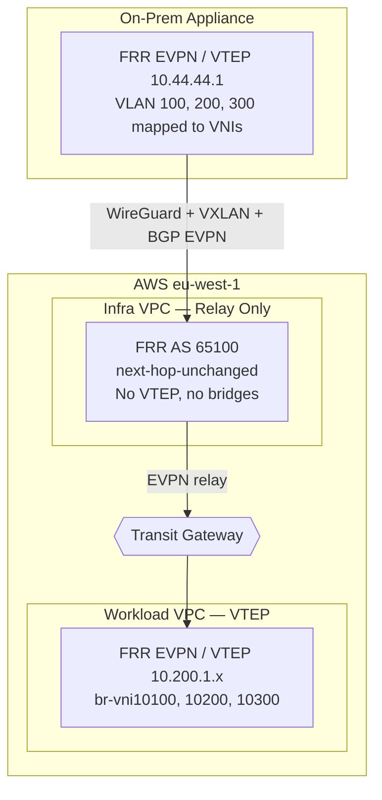

### Roles of Each Component

**On-prem appliance** — EVPN VTEP (PE router). Maps local VLANs (via
trunk bridge + 802.1Q sub-interfaces) to VXLAN VNIs. Runs FRR with BGP
EVPN to advertise local MACs and learn remote MACs. Peers with the infra
relay.

**Infra VPC router** — EVPN route relay / route reflector. Peers BGP
EVPN with both the on-prem appliance and all cloud-side VTEPs. Uses
`next-hop-unchanged` so EVPN routes carry the original VTEP IPs
end-to-end. Has **no VXLAN interfaces, no bridges** — it is a pure
control-plane component.

**Workload VPC router / OCP node** — EVPN VTEP (PE router). Creates
per-VNI VXLAN interfaces and bridges. In the PoC this is a standalone
FRR instance; in production with OCP 4.22+ this role is fulfilled
natively by the OCP worker nodes via FRR-K8s and OVN-Kubernetes EVPN.

**Transit Gateway** — AWS-managed IP router connecting all VPCs and
DX/VPN attachments. TGW operates at L3 only — it routes IP packets
based on its route table. It does not understand VXLAN or EVPN; it
simply forwards the outer IP packet to the correct VPC attachment based
on the destination IP.

### BGP Topology — Why the Relay Exists

The infra relay prevents full-mesh BGP between every on-prem PE and
every cloud PE. Without it, N on-prem appliances and M cloud VTEPs
(OCP nodes) would require N×M BGP sessions. With the relay, each
side peers only with the relay: N+M sessions total.

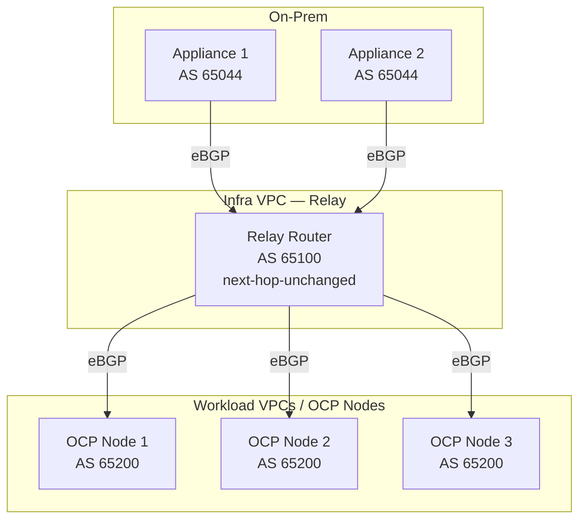

In a production deployment with 2 on-prem appliances and 50 OCP worker
nodes, the relay handles 52 BGP sessions instead of 100 (2×50). The
relay can also be deployed as a pair for HA.

Each side uses a private ASN. Route targets differ per ASN, so each VTEP
explicitly imports both its own and the remote ASN's RTs:

```
rt import 65044:<VNI>    ← on-prem routes
rt import 65200:<VNI>    ← workload routes
rt export <local_asn>:<VNI>
```

### Control Plane vs Data Plane — Is the Relay in the Path?

The critical property of `next-hop-unchanged`: the EVPN routes carry
the **original VTEP IP** as the BGP next-hop, not the relay's IP.
When OCP Node 1 receives a Type-2 route for an on-prem MAC, the next-hop
is `10.44.44.1` (the on-prem appliance), not the relay. VXLAN traffic
therefore targets the on-prem appliance directly.

**Whether the relay is in the data path depends on the tunnel type:**

#### Direct Connect or IPSec (TGW-terminated) — Relay is control-plane only

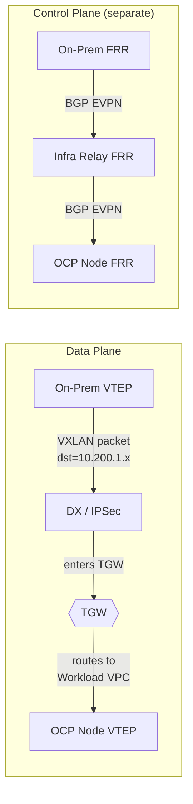

With DX or IPSec, traffic enters AWS via the DX Gateway or VPN
attachment, both of which terminate directly on the TGW. The TGW's
route table knows:

- `10.200.0.0/16 → Workload VPC attachment` (propagated from VPC attachment)
- `10.44.44.0/24 → DX/VPN attachment` (propagated via BGP from on-prem)

So when a VXLAN packet arrives from on-prem with destination
`10.200.1.47` (an OCP node), TGW routes it directly to the workload
VPC. **The infra VPC never sees the data-plane packet.** It only
participates in the BGP EVPN control plane.

Similarly, return traffic from the OCP node (dst `10.44.44.1`) is
routed by TGW directly to the DX/VPN attachment back to on-prem.

#### WireGuard — Relay IS in the data path

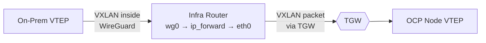

With WireGuard, the tunnel terminates on the infra EC2 instance (not
on TGW — AWS has no WireGuard support). The infra router receives the
VXLAN packet on `wg0`, then Linux `ip_forward` routes it via `eth0`
through the TGW to the workload VPC. The relay is in both the control
plane and the data path. This is why WireGuard is dev/test only.

### TGW Route Awareness

For the data plane to bypass the infra VPC, TGW must have routes to
all VTEP IPs. This happens automatically:

| Route | How TGW Learns It |
|---|---|
| Workload VPC CIDRs (contain VTEP IPs) | **VPC attachment propagation** — TGW automatically learns the CIDR of every attached VPC |
| On-prem VTEP CIDR (e.g. 10.44.44.0/24) | **BGP propagation** — the on-prem appliance advertises its prefix via BGP over the DX/VPN attachment, TGW installs it in its route table |

No static routes needed. TGW's route table contains everything it needs
to forward VXLAN packets directly between any pair of VTEPs.

### Why the Infra VPC Still Exists (Even When Not in the Data Path)

With DX or IPSec, the infra router is pure control plane. But it still
provides essential value:

1. **Prevents full-mesh BGP** — without the relay, every on-prem
   appliance would need a BGP session to every OCP node (N×M). The
   relay collapses this to N+M.

2. **Single point for policy** — route filtering, prefix lists,
   community tagging, and AS path manipulation happen in one place
   rather than on every PE.

3. **Decouples on-prem from cloud topology** — on-prem appliances only
   know about the relay, not about individual OCP nodes. Adding or
   removing OCP nodes requires no on-prem config changes.

4. **HA boundary** — the relay can be deployed as a pair (two EC2
   instances with BGP ECMP) independently of on-prem or cloud-side HA.

### VTEP IP Assignment — Use the Node IP

Each EVPN VTEP needs a routable IP that remote VTEPs can target for
VXLAN encapsulated traffic. There are three options:

| Approach | VTEP IP | Example |
|---|---|---|
| **Node IP** (recommended) | Node's primary private IP | `10.200.1.47` |
| Dedicated loopbacks | Separate /32 range outside VPC CIDR | `100.64.0.1/32` |
| Secondary VPC IPs | /32 from within VPC CIDR on ENI | `10.200.100.1/32` |

**Recommendation: VTEP = node's primary private IP.** The reason is
TGW routing.

TGW learns routes via two mechanisms: **VPC attachment propagation**
(automatically learns the CIDR of each attached VPC) and **BGP
propagation** (from DX/VPN attachments only). TGW does not peer BGP
with VPC attachments — it has no visibility into what IPs exist inside
a VPC beyond the VPC CIDR.

This means:

- **Node IP `10.200.1.47`** — falls within the VPC CIDR `10.200.0.0/16`.
  TGW routes it to the workload VPC automatically. VPC internal routing
  delivers it to the correct ENI. **Just works, zero config.**

- **Dedicated loopback `100.64.0.1/32`** — not in any VPC CIDR. TGW has
  no route to it. The packet is dropped. You would need a static TGW
  route (`100.64.0.0/24 → workload VPC attachment`) AND a per-node VPC
  route table entry (`100.64.0.1/32 → eni-xxx`). This doesn't scale
  and breaks every time a node is added or removed.

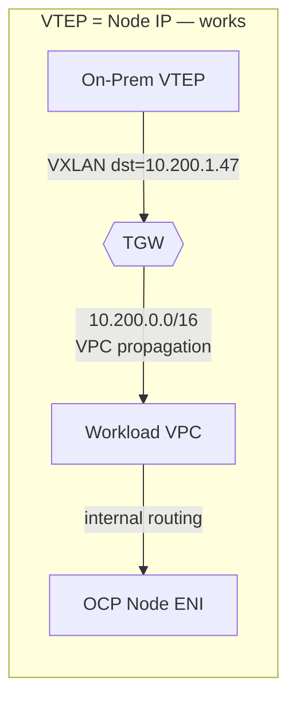

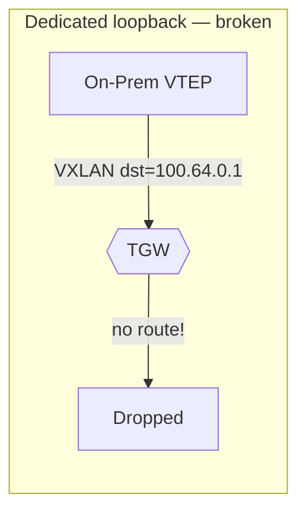

Additional benefits of using the node IP:

- **Node scaling is transparent** — adding an OCP node adds a VTEP
  automatically. TGW doesn't need updates; it routes the entire VPC
  CIDR already.
- **Matches existing OVN-Kubernetes behaviour** — OVN already uses the
  node IP as the GENEVE tunnel endpoint. Using it for EVPN VXLAN is
  the same pattern.
- **No IGP needed** — traditional DC fabrics use OSPF/IS-IS to
  distribute loopback /32s. AWS has no IGP between VPCs and TGW.
  Using the node IP avoids this gap entirely.

Dedicated loopbacks make sense in a traditional DC fabric with a shared
IGP. In AWS with TGW, they create routing problems that don't need to
exist.


## 3. VLAN-to-VNI Mapping

The customer defines stretches in a single YAML file (`group_vars/all.yml`).
Everything else is auto-derived:

```yaml
stretches:
  - vlan: 100
    name: production
    subnet: 10.42.1.0/24
    onprem_gateway: 10.42.1.1
    cloud_gateway: 10.42.1.2
```

| Customer Provides | Ansible Derives |
|---|---|
| VLAN ID (100) | VNI: 10100 (`10000 + VLAN`) |
| Subnet (10.42.1.0/24) | Bridge SVIs, VXLAN interface names |
| *(nothing)* | Route distinguisher: `<vtep_ip>:<vni>` |
| *(nothing)* | Route targets: `<asn>:<vni>` (import both sides) |
| *(nothing)* | FRR config stanzas (Jinja2 templates) |
| *(nothing)* | Linux interfaces: `trunk.<vlan>`, `vxlan<vni>`, `br-vni<vni>` |

### Per-Stretch Data Plane

For each stretch, Ansible creates:

**On-prem:**

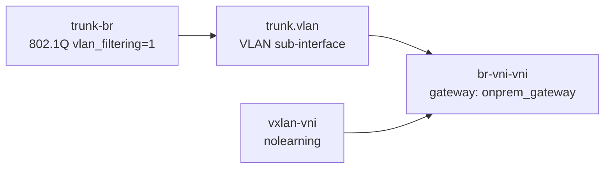

**Cloud (workload VPC):**

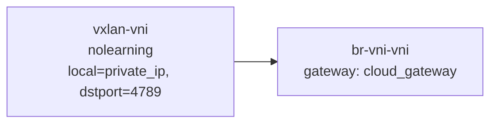

The `nolearning` flag on VXLAN interfaces means all MAC learning is
driven by BGP EVPN Type-2 routes, not data-plane flooding. This is
the same control-plane-driven model used by production EVPN fabrics.


## 4. Tunnel Underlay

The `tunnel.type` variable gates all tunnel-specific tasks:

```yaml
tunnel:
  type: wireguard        # or 'ipsec' or 'direct-connect'
  mtu_mode: safe         # or 'unsafe'
```

### Supported Tunnel Types

| Type | Cloud Side | On-Prem Side | MTU | Use Case |
|---|---|---|---|---|
| `wireguard` | Infra VPC EC2 | Appliance (wg-quick) | ~1400 inner | Dev/test |
| `ipsec` | AWS TGW (Site-to-Site VPN) | Appliance (Libreswan) | 1399 (AWS-imposed) | Customers without DX |
| `direct-connect` | AWS DX Gateway → TGW | Customer's DX circuit | Up to 9001 (jumbo) | Production |

**WireGuard** — terminates on the infra VPC router. Ansible generates
keys, deploys configs, opens SG rules. Works behind NAT, zero cost.
Gated: all WireGuard tasks skipped when `tunnel.type != 'wireguard'`.

**IPSec** — AWS Site-to-Site VPN. Two endpoints:

- **Cloud side:** terminates on the AWS Transit Gateway. AWS manages
  the IPSec negotiation, encryption, and tunnel redundancy (two tunnels
  per VPN connection for HA). No IPSec software on the EC2 instances.
- **On-prem side:** terminates on the appliance itself, running
  Libreswan. Ansible installs Libreswan, generates the tunnel config
  from the AWS VPN connection parameters (tunnel IPs, PSKs, IKE/ESP
  settings), and starts the IPSec tunnels.

**Constraint:** AWS requires the Customer Gateway to have a
public IP address. The appliance (or the NAT device in front of it)
must have a static, internet-routable IP that AWS can target. NAT-T
(NAT Traversal, UDP 4500) is supported if the appliance is behind NAT,
but the public IP must still be known and registered as the Customer
Gateway address.

Ansible creates the Customer Gateway, VPN Connection, and configures
Libreswan on the appliance with the tunnel parameters. The BGP session
runs over the VPN tunnel inside addresses (169.254.x.x link-local),
provided by AWS.

**Direct Connect** — Ansible skips all tunnel setup and only configures
FRR, VXLAN, and bridges. Assumes IP reachability between VTEPs already
exists via the customer's DX circuit.

### MTU Modes

VXLAN adds 50 bytes of encapsulation to every inner frame. Whether that
fits depends on the underlay MTU:

| Underlay | Path MTU | VXLAN (1550) fits? |
|---|---|---|
| WireGuard over internet | ~1400 | No |
| AWS Site-to-Site VPN | 1399 | No |
| Direct Connect (default) | 1500 | No |
| Direct Connect (jumbo) | 9001 | Yes |
| Any underlay ≥ 1600 | ≥ 1600 | Yes |

The `mtu_mode` setting controls how the appliance handles this:

#### `mtu_mode: safe` (default)

Requires underlay MTU ≥ 1550. The appliance does not clamp, fragment,
or modify frames. Inner VMs can send full 1500-byte frames and they
traverse the VXLAN tunnel without any adjustment.

**Required for:** Direct Connect with jumbo frames, or any underlay
where the path MTU is ≥ 1600 end-to-end.

#### `mtu_mode: unsafe`

For underlays where the path MTU is below 1550 (WireGuard, IPSec, DX
without jumbo). The appliance takes two measures to avoid fragmentation:

1. **DF bit is always set on outer VXLAN packets.** Packets that exceed
   the tunnel MTU are **dropped, not fragmented**. Fragmentation is
   never acceptable (CPU slow-path, doubled packet loss, reassembly
   overhead — see below).

2. **TCP MSS clamping** on the bridge interfaces. The appliance rewrites
   the TCP MSS in SYN packets transiting the bridge so that TCP
   connections negotiate a segment size that fits within the tunnel MTU
   after VXLAN encapsulation. This ensures TCP traffic flows without
   drops. Configured via `iptables -t mangle -A FORWARD -p tcp --tcp-flags SYN,RST SYN -j TCPMSS --clamp-mss-to-pmtu` on each bridge.

**Documented rough edges with `unsafe` mode:**

- **UDP traffic > tunnel MTU will be silently dropped.** There is no
  MSS equivalent for UDP. Applications sending large UDP datagrams
  (e.g., NFS, iSCSI, some database replication) will fail.
- **ICMP PMTUD may not work.** Many firewalls and cloud security groups
  block ICMP "need to fragment" messages. If PMTUD fails, TCP falls
  back to MSS clamping (which we configure), but UDP has no fallback.
- **Live VM migration will not work.** Live migration
  protocols send large frames that exceed the clamped MTU and do not
  honour MSS clamping (they use their own protocol, not TCP).
- **Not recommended for production.** This mode exists for dev/test
  environments and for customers who understand the limitations.

### Why Never Fragment

IP fragmentation is explicitly avoided in both modes:
- Routers fragment on the **CPU slow path**, not in hardware ASICs
- Reassembly requires buffering, reordering, timeout handling — also CPU
- A single lost fragment drops the entire inner VM packet, **doubling
  effective packet loss** for large frames
- Every serious VXLAN deployment mandates jumbo MTU on the underlay
  and sets DF on encapsulated packets

The appliance **always sets DF** on outer VXLAN packets. Oversized
packets are dropped and an ICMP "need to fragment" is sent back to the
source VM, allowing PMTUD to converge (when ICMP is not blocked).

### DX Partner Model

For production deployments with `mtu_mode: safe`, the customer needs a
Direct Connect circuit with jumbo frames from a DX partner.

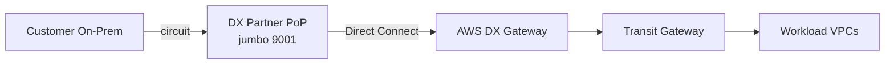

We provide: on-prem appliance, cloud automation, EVPN overlay.
We don't provide: the underlay circuit.


## 5. Appliance Platform

### What Runs on the Box

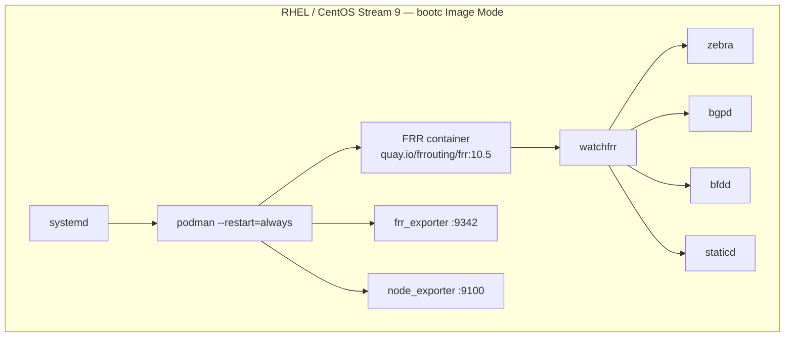

Config pushed by Ansible over SSH. No custom agents. No custom code. All upstream.

### Why bootc Image Mode

- **Atomic updates** — `bootc upgrade` pulls a new image, stages it for
  next boot. If it breaks, `bootc rollback` reverts instantly. Critical
  for a network appliance where a bad update = total outage.
- **Reproducible** — same Containerfile builds the qcow2 (on-prem) and
  AMI (AWS). One artifact, one CI pipeline.
- **Pre-baked** — wireguard-tools, podman, FRR systemd service,
  exporters, IP forwarding, SSH keys all baked in. Ansible only pushes
  config, never installs packages.

### Why FRR in a Container (Not RPM)

The FRR container image (`quay.io/frrouting/frr:10.5.3`) is the same
upstream image used by OVN-Kubernetes and FRR-K8s in OpenShift. One
artifact, one vulnerability scan, tested in the same CI.

### Process Supervision (Three Layers)

| Layer | Handles | Recovery Time |
|---|---|---|
| **watchfrr** | bgpd/zebra/bfdd crash | < 1 second |
| **podman --restart=always** | FRR container crash | 1-5 seconds |
| **systemd** | podman/container runtime crash | 1-5 seconds |

Data plane survives control plane crashes: the Linux kernel's FIB,
VXLAN interfaces, and bridges keep forwarding with last-known routes
while bgpd restarts and re-establishes BGP sessions (~5-10 seconds).

### Monitoring

**frr_exporter** scrapes FRR state via vtysh and exposes Prometheus
metrics on `:9342`. The FRR container shares `/var/run/frr` to the host
so the exporter can access vtysh sockets.

**node_exporter** provides system metrics on `:9100`.

Both run as podman containers. On bootc images, they're baked in as
systemd services. On non-bootc, Ansible deploys them.

We ship metric endpoints and reference alert rules. Where the customer
runs Prometheus + Grafana is their choice.


## 6. Config Management — Ansible

Ansible is the control plane for the entire lifecycle. No custom agents,
no operators, no CRDs.

### Source of Truth

```
ansible/
├── inventory/
│   ├── hosts.yml              ← appliance + cloud router IPs
│   └── group_vars/all.yml     ← stretches, tunnel, BGP config
├── playbooks/
│   ├── provision-aws.yml      ← create AWS infra from scratch
│   ├── deploy.yml             ← configure EVPN (idempotent)
│   ├── health-check.yml       ← validate end-to-end
│   ├── teardown.yml           ← remove EVPN config
│   └── teardown-aws.yml       ← destroy AWS infrastructure
└── roles/
    ├── evpn_aws_infra/        ← VPCs, TGW, EC2, SGs, routes
    ├── evpn_cloud_infra/      ← WireGuard + FRR relay
    ├── evpn_cloud_workload/   ← VXLAN bridges + FRR VTEP
    ├── evpn_onprem_appliance/ ← VLANs + VXLAN + FRR VTEP
    ├── evpn_monitoring/       ← frr_exporter + node_exporter
    └── evpn_health_check/     ← 16 automated checks
```

### Day-1: Deploy

```bash
ansible-playbook playbooks/provision-aws.yml   # VPCs, TGW, EC2 (~5 min)
ansible-playbook playbooks/deploy.yml          # EVPN overlay (~3 min)
ansible-playbook playbooks/health-check.yml    # Validate (~1 min)
```

### Day-2: Add a VLAN

```yaml
# Edit group_vars/all.yml, add:
  - vlan: 400
    name: database
    subnet: 10.42.4.0/24
    onprem_gateway: 10.42.4.1
    cloud_gateway: 10.42.4.2
```

```bash
ansible-playbook playbooks/deploy.yml   # idempotent, only adds the new stretch
```

FRR's `advertise-all-vni` auto-discovers the new VNI from the kernel.
Existing stretches are untouched.

### AAP Integration

For customers with Ansible Automation Platform:
- Import playbooks as **Job Templates** with survey prompts
- **Webhook trigger** from Git for GitOps-style deploys
- **Scheduled health checks** as recurring Job Templates
- Built-in audit trail, RBAC, approval workflows


## 7. High Availability

### Phase 1 (Current): Single Appliance

Acceptable for migration windows (not permanent stretched production).
FRR restarts via watchfrr/podman/systemd. If the appliance dies, all
stretched VLANs go dark until manual recovery.

### Phase 2: EVPN All-Active Multi-Homing

Two appliances, LACP bond toward the upstream switch or edge bridge,
shared Ethernet Segment ID. FRR supports this natively.

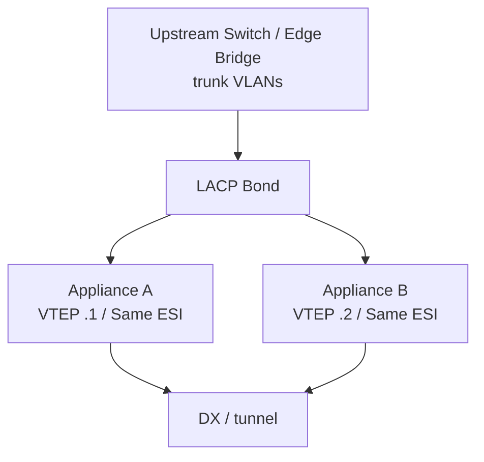

Both appliances are active simultaneously. EVPN Type-1 (EAD) and
Type-4 (ES) routes handle Designated Forwarder election (which appliance
forwards BUM traffic per VLAN) and fast failover. With BFD at 50ms × 3,
failover is ~150ms.

### Failure Scenarios

| Failure | Impact | Recovery |
|---|---|---|
| bgpd crashes | watchfrr restarts in < 1s. BGP re-establishes in ~5s. | Automatic |
| FRR container dies | podman restarts. ~15-30s to full convergence. | Automatic |
| Appliance hardware failure | HA peer takes over via BFD (~150ms). | Automatic (with MH) |
| DX circuit flap | VXLAN packets can't reach cloud. Local VLAN traffic unaffected. | Automatic on recovery |
| Infra relay failure | Existing VXLAN tunnels continue until BGP hold-timer (90s). | EC2 auto-recovery |


## 8. Health Checks

The `evpn_health_check` role runs 16 automated checks across all 3 hosts:

**Infra router:**
- FRR container running
- WireGuard interface up (if tunnel.type == wireguard)
- BGP session to workload is Established
- BGP session to on-prem is Established
- EVPN prefixes relayed from on-prem (pfxRcd > 0)
- EVPN prefixes relayed from workload (pfxRcd > 0)
- No VXLAN interfaces exist (confirms relay-only role)

**Workload router:**
- FRR container running
- BGP session to infra is Established
- Each VNI has ≥ 1 remote VTEP
- Ping to on-prem gateway succeeds per stretch

**On-prem appliance:**
- FRR container running
- WireGuard interface up (if tunnel.type == wireguard)
- BGP session to infra is Established
- Each VNI has ≥ 1 remote VTEP
- Ping to cloud gateway succeeds per stretch
- Simulated VMs can ping cloud gateways (if trunk_interface == simulate)
- VLAN isolation: VM on VLAN 100 cannot reach VM on VLAN 200


## 9. Roadmap

### Phase 1 — MVP (Done)

- Ansible collection (6 roles, 5 playbooks)
- bootc appliance image (Containerfile, qcow2 build, AMI build script)
- Multi-VLAN stretch (3 VLANs proven)
- WireGuard dev/test tunnel (gated on `tunnel.type`)
- Automated health checks (16 checks)
- Monitoring endpoints (frr_exporter + node_exporter)

### Phase 2 — HA + DX Partner

- EVPN multi-homing (dual appliance, LACP bond, BFD)
- Direct Connect partner integration playbooks
- MTU validation (hard-block if < 1550)
- Real trunk port to upstream switch / edge bridge
- Reference Grafana dashboard JSON + alert rules

### Phase 3 — AAP Integration + Production Hardening

- AAP Job Templates with survey prompts
- Webhook-triggered GitOps deploys
- bootc upgrade/rollback playbooks
- Security hardening (SSH key rotation, FIPS mode)
