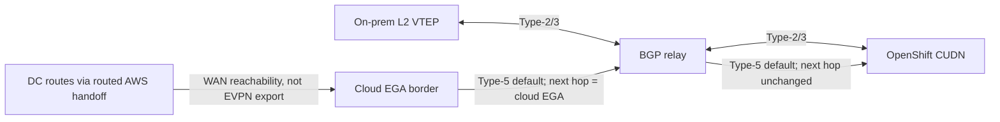
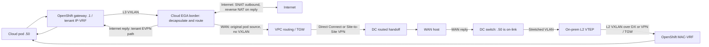
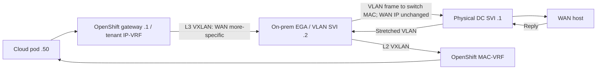

# Layer 3 egress from a stretched Layer 2 network

**Status: proposed design, not a supported deployment topology.** The MVP candidate is
cloud-border egress. Qualify it on the selected OpenShift payload; AWS support approval is
separate from interoperability. See the [EVPN primer](evpn-primer.md) and
[networking handoff](networking-spec.md).

## Gateway ownership

Example (using documentation addresses): a primary L2 CUDN stretches `192.0.2.0/24` to a
physical DC VLAN. A cloud pod uses `192.0.2.50`; the physical switch keeps its existing SVI
and remains the DC hosts' default gateway at `192.0.2.1`. In the routed profiles, OpenShift
also answers for `192.0.2.1` as the **pod-facing** gateway. The CUDN uses a MAC-VRF for same-subnet traffic
and an IP-VRF for routed traffic. Tenant traffic does not leak into the OpenShift workers'
default VRF.

Using the same gateway IP on both sides is a qualification requirement, not an assumption
that the neighbor bindings will stay separate. Verify that pods reach the OpenShift gateway
and DC hosts reach the physical switch, including after neighbor caches are cleared. This
proposal does not change the DC SVI, existing hosts' default gateway, or the DC's connected
route for the stretched subnet.

## MVP: cloud border with asymmetric WAN return

Cloud EGA adds a forwarding VTEP and tenant IP-VRF. The existing BGP relay remains a
separate logical role and is **not** a packet hop. On-prem EGA still attaches the physical
VLAN to EVPN. Type-2/3 exchange supports the L2 stretch. Cloud EGA originates the tenant's
Type-5 IPv4 default with its own VTEP as next hop; the relay preserves that next hop.
Import the default only into the intended OpenShift IP-VRF, not on-prem. Do not originate
or import on-prem WAN Type-5 specifics in this profile.

The border decides between the two exits. An Internet packet is SNATed to an address with
working Internet egress and a return path to that border. A configured WAN destination
(e.g. `198.51.100.10` matching `198.51.100.0/24`) uses the routed AWS-to-DC path **without
SNAT**. Use a static WAN route in the reference topology; unicast BGP is an alternative.
The route must be usable from the border's tenant forwarding path, not merely present in
its default VRF or an AWS route table. If the WAN route disappears, the Internet default
can be selected; MVP does not guarantee fail-closed behavior. RFC1918 addresses are not
publicly routed, but a private or overlapping route can still match.

The WAN return path assumes the DC switch can resolve the cloud pod on the stretched
VLAN and deliver the reply via the MAC-VRF. It intentionally bypasses cloud EGA. Do not
advertise the stretched `/24` into the routed AWS/DC path just to make the paths symmetric.
A deployment that requires symmetric stateful inspection must qualify that requirement
separately; the default WAN path shown here does not provide it.

DX or VPN must carry VXLAN between VTEPs for the stretch. If routed WAN egress is enabled,
the VPC, TGW, and DC handoff must also carry the **inner tenant IP packet**, without VXLAN
but still protected by IPsec on the VPN path. The documented Site-to-Site VPN terminates
between TGW and on-prem EGA; in that topology on-prem EGA must route the decapsulated IP
packet onward to DC routing. Do not infer that capability from working VTEP reachability.

[BGP Cloud Connector](https://github.com/openshift/bgp-cloud-connector) can help reconcile
OpenShift worker peering with AWS VPC Route Server for underlay reachability. It is not an
MVP dependency for the cloud border's WAN routes. Worker-direct WAN egress is a separate
architecture; learning routes in the worker's default VRF does not make them available to
this EVPN CUDN.

## Post-MVP: on-prem WAN exit, symmetric by site

This alternative puts both WAN directions through on-prem EGA, but uses routed forwarding
outbound and L2 bridging on return. Cloud EGA still handles Internet egress. On-prem EGA
uses `192.0.2.2` on the VLAN and learns selected WAN prefixes statically or dynamically via
the physical `192.0.2.1`. It exports those prefixes as tenant Type-5 routes with itself
as next hop. OpenShift selects those more-specific routes over the cloud default.

Validate OpenShift's MAC-VRF/IP-VRF transitions for the outbound and return paths rather
than assuming a supported node-local hairpin. Prove that `.2` resolves `.1` to the physical
switch. Export only intended WAN prefixes, not the stretched subnet or a learned default.
Test withdrawal: a lost WAN more-specific can expose the Internet default; AS-path
prepending alone does not prevent that. Treat this and the cloud-border profile as
alternatives, not automatic failover modes.

## Stretch goal: DC-owned pod gateway

Keep the CUDN as a MAC-VRF stretch with no OpenShift-owned `.1` SVI. Pods would bridge
traffic for the physical gateway across the stretch, while same-subnet traffic would stay
bridged. This mode is not available in OpenShift today. It requires a supported way to
leave gateway ownership at the DC and give pods a usable default route.

## Qualification

On the selected OpenShift payload and transport, check the tenant route import and actual
forwarding entries, then exercise bidirectional sessions:

- **Same subnet:** pod ↔ DC VLAN host over L2 without routing via a gateway. Verify neighbor
  resolution, including that neither side's `.1` binding steals traffic intended for the other.
- **Internet:** pod ↔ Internet through cloud EGA. Observe outbound SNAT and return through
  the same border's reverse NAT; verify on-prem does not import the cloud default.
- **WAN (when enabled):** observe the original pod source after cloud decapsulation and at
  the DC handoff, and observe the reply enter EVPN through the on-prem L2 VTEP. Test through
  deployed stateful policy points and record behavior after WAN route withdrawal.

Capture the relevant forwarding and neighbor state and packets at the VTEPs and DC handoff.
Passing BGP or VTEP reachability checks alone does not qualify these flows.
